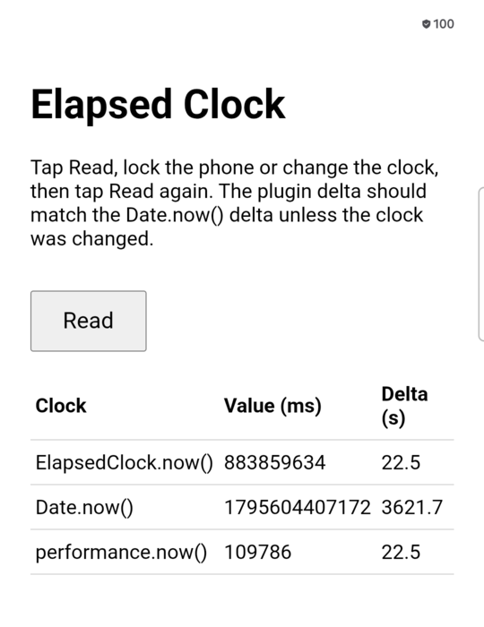

# capacitor-elapsed-clock

A Capacitor plugin that reads the device elapsed clock: the time since boot, counting while the phone sleeps. The user cannot move it by changing the date or time, so it works for things like lockouts and cooldowns that must not end early when someone sets the clock forward.



The [example app](example-app) on a Samsung Galaxy A57, after moving the phone clock forward one hour between two reads: `Date.now()` jumped an hour, `ElapsedClock.now()` only counted the 22.5 real seconds.

| Platform | Clock | Counts sleep | Resets |
| -------- | ----- | ------------ | ------ |
| Android  | `SystemClock.elapsedRealtime()` | yes | on reboot |
| iOS      | `clock_gettime_nsec_np(CLOCK_MONOTONIC_RAW)` (same as `mach_continuous_time`) | yes | on reboot |
| Web      | `performance.now()` | not always | on page load |

Works with Capacitor 7 and 8.

## Install

```bash
npm install capacitor-elapsed-clock
npx cap sync
```

## Usage

```typescript
import { ElapsedClock } from 'capacitor-elapsed-clock';

const { value: start } = await ElapsedClock.now();
// save `start` together with your data

// later, maybe after the app was closed
const { value: now } = await ElapsedClock.now();
// a lower reading means the device rebooted, so count nothing for that gap
const elapsed = now >= start ? now - start : 0;
```

After a reboot you cannot know how much time passed, so the safe choice for a lockout is to count none of it and save the new reading.

A higher reading does not prove there was no reboot. Across a reboot the difference comes out shorter than the real time, never longer. That is fine for lockouts and cooldowns, but do not use it for things that must expire on time, like sessions.

## API

<docgen-index>

* [`now()`](#now)
* [Interfaces](#interfaces)

</docgen-index>

<docgen-api>
<!--Update the source file JSDoc comments and rerun docgen to update the docs below-->

### now()

```typescript
now() => Promise<NowResult>
```

Read the elapsed clock.

On Android and iOS the value is the time since the device booted. It
keeps counting while the device sleeps, and changing the date, time or
time zone does not move it. It goes back to zero on reboot. A reading
lower than one you saved means the device rebooted in between. A higher
reading does not prove there was no reboot: across a reboot the
difference comes out shorter than the real time, never longer. That is
safe for lockouts and cooldowns, not for things that must expire on time.

On web it is `performance.now()`, which starts again on every page load
and may not count while the device sleeps.

**Returns:** <code>Promise&lt;<a href="#nowresult">NowResult</a>&gt;</code>

**Since:** 0.1.0

--------------------


### Interfaces


#### NowResult

| Prop        | Type                | Description                                                             | Since |
| ----------- | ------------------- | ----------------------------------------------------------------------- | ----- |
| **`value`** | <code>number</code> | Milliseconds since an arbitrary point (device boot on Android and iOS). | 0.1.0 |

</docgen-api>
